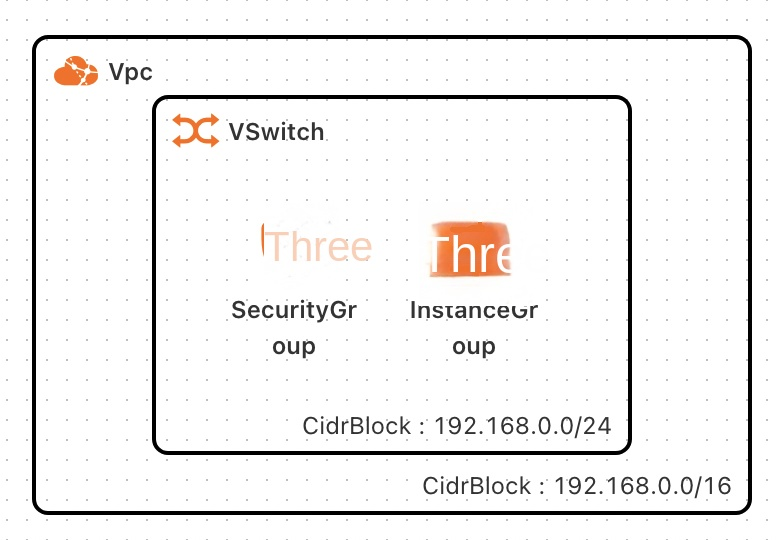
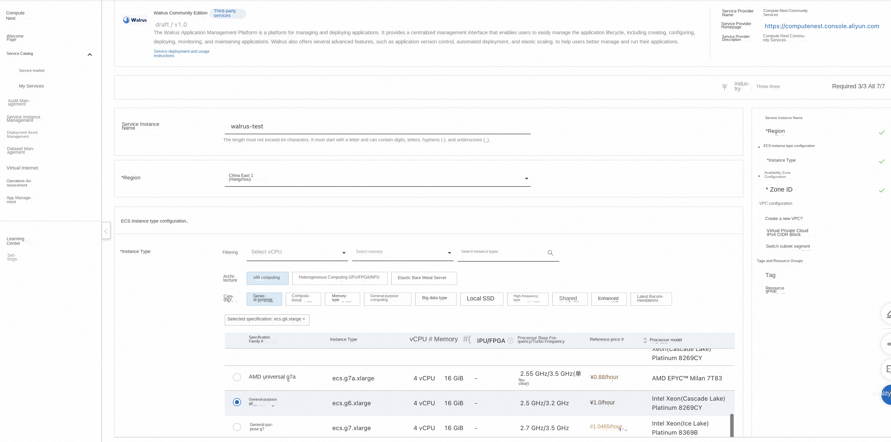
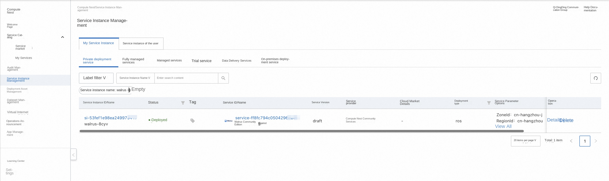
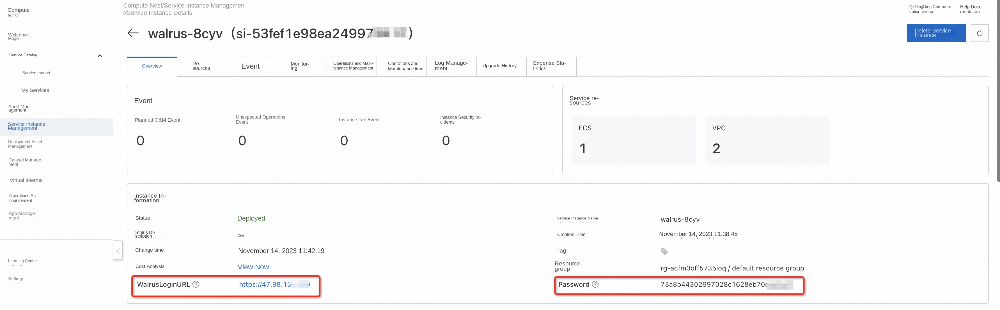
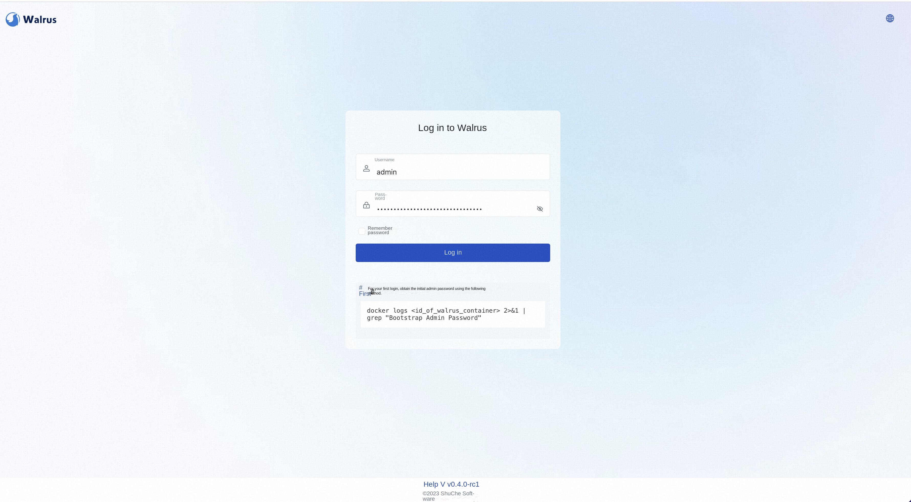

# Walrus Service Instance Deployment Documentation

> **Disclaimer:**
>
> This service is provided by a third party. We try our best to ensure its safety, accuracy and reliability, but we cannot guarantee that it is completely free from failure, interruption, error or attack. Therefore, the company hereby declares that it makes no representations, warranties or commitments regarding the content, accuracy, completeness, reliability, suitability and timeliness of the Service and is not liable for any direct or indirect loss or damage arising from your use of the Service; for third-party websites, applications, products and services that you access through the Service, do not assume any responsibility for its content, accuracy, completeness, reliability, applicability and timeliness, and you shall bear the risks and responsibilities of the consequences of use; for any loss or damage arising from your use of this service, including but not limited to direct loss, indirect loss, loss of profits, loss of goodwill, loss of data or other economic losses, even if we have been advised in advance of the possibility of such loss or damage; we reserve the right to amend this statement from time to time, so please check this statement regularly before using the Service. If you have any questions or concerns about this Statement or the Service, please contact us.

## Overview
The Walrus Application Management Platform is a platform for managing and deploying applications. It provides a centralized management interface that enables users to easily manage the application lifecycle, including creating, configuring, deploying, monitoring, and maintaining applications. Walrus also offers advanced features such as application versioning, automated deployment, and elastic scaling to help users better manage and run their apps.

This article shows you how to provision Walrus on the computing nest, as well as the deployment process and usage instructions.

## Billing Description

Walrus's expenses on computing nests relate primarily:

-Selected vCPU and memory specifications
-System disk type and capacity
-Public network bandwidth

## Deployment Architecture

## Required Permissions for RAM Users

The Walrus service needs to access and create resources such as ECS and VPC. If you use a RAM user to create a service instance, you need to add the corresponding resource permissions to the account of the RAM user before creating the service instance. For details about how to add RAM permissions, see [RAM User Authorization](https://help.aliyun.com/document_detail/121945.html)
。 The required permissions are shown in the table below.

| Permission policy name | Comment |
| --------------------------------------- | --------------------------------- |
| AliyunECSFullAccess | Permissions to manage ECS instances |
| AliyunVPCReadOnlyAccess | Read-only access to VPC |
| AliyunROSFullAccess | Manage permissions for Resource Orchestration Service (ROS) |
| AliyunComputeNestUserFullAccess | Manage user-side permissions for the compute nest service (ComputeNest) |

## Deployment process

### Deployment Steps

Click [Deployment Link](https://computenest.console.aliyun.com/service/instance/create/cn-hangzhou?type=user&ServiceId=service-ff8fc794c05042968b39) to enter the service instance deployment page, and fill in the parameters according to the interface prompts to complete the deployment.

### Deployment Parameter Description

During the process of creating a service instance, you need to configure the service instance information. The details of the Walrus service instance input parameters are described below.

| Parameter Group | Parameter Item | Example | Description |
| ---------- | ------------ | -------------------------- | -------------------------- |
| Service instance name | | walrus-test | Name of the instance |
| Region | | cn-hangzhou | Select the region of the service instance. We recommend that you select the region nearby to obtain better network latency. |
| ECS instance configuration | Instance type | ecs.g6.large | ECS instance type, which can be selected according to actual needs. |
| zone configuration | zone | cn-hangzhou-j | different zones in different regions. |
| Network Configuration | Whether to create a VPC | true | |
| Network Configuration | VPC IPv4 CIDR block | 192.168.0.0/16 | |
| Network Configuration | Switch Subnet Segment | 192.168.1.0/24 | |
| Network configuration | VPC instance ID | vpc-\*\*\*\*\*\* |
| Network Configuration | VSwitch Instance ID | vsw-\*\*\*\*\*\* |

### Verification Results

1. View the service instance. After the service instance is created successfully, the deployment time takes about 5 minutes. After deployment is complete, you can see the corresponding service instances on the page.

2. Access Walrus through a service instance. After entering the corresponding service instance, you can obtain the address of the Walrus login page and the initial password of the admin account on the page.

3. After successful login, configure and use Walrus.

## Help documentation

Please visit the [Walrus User's Guide](https://github.com/seal-io/walrus) to learn how to use it.